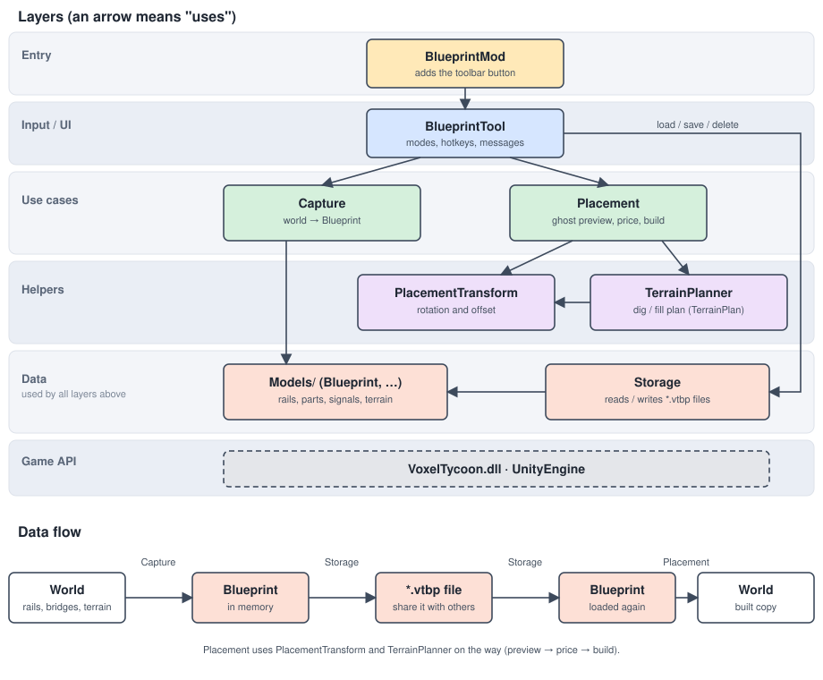

# Contributing

Thanks for helping with Rail Blueprints. Bug reports, ideas and pull requests are welcome on
[GitHub](https://github.com/malteb247/voxeltycoon_blueprint_mod). How to use the mod is described in the
[README](README.md); this file is about working on the code.

## Prerequisites

- The .NET SDK 8 or newer.
- Voxel Tycoon, installed. The mod and the tests reference `VoxelTycoon.dll` and the Unity DLLs of the game. They are
  not part of this repository and must not be added to it.

## Repository layout

```
BlueprintMod.sln
Directory.Build.props        settings shared by all projects, default game paths
.editorconfig                code style, checked by every build
README.md                    for players
CONTRIBUTING.md              for developers (this file)
LICENSE                      MIT
docs/                        architecture diagram
src/BlueprintMod/            the mod: code, mod.json, preview.png
tests/BlueprintMod.Tests/    unit tests
```

## Code overview

All files below are in `src/BlueprintMod/`.

| File                                  | Purpose                                                   |
|---------------------------------------|-----------------------------------------------------------|
| `BlueprintMod.cs`                     | Mod entry point, adds the toolbar button                  |
| `BlueprintTool.cs`                    | Input, modes and hotkey panel                             |
| `Capture.cs`                          | World -> `Blueprint`                                      |
| `Placement.cs`                        | Ghost preview, price/validity, building the blueprint     |
| `PlacementTransform.cs`               | Rotation and offset of saved positions                    |
| `TerrainPlan.cs`, `TerrainPlanner.cs` | Which terrain columns to dig or fill                      |
| `Models/`                             | Data model, one file per type (`Blueprint`, `RailEntry`, ...) |
| `Storage.cs`                          | Reading and writing `.vtbp` files                         |
| `Serializer.cs`                       | File format: `Blueprint` <-> lines of text                |
| `Validator.cs`, `AssetLibraryExtensions.cs` | Validation of loaded files, safe asset lookup       |

## Architecture



Each layer only uses the layers below it. `BlueprintTool` is the only class that deals with input and UI, capture and
placement are independent of each other, and the data model (`Models/`) is plain data that every
layer can use. One small dependency is not drawn: capture asks `Storage` for the next free blueprint name.

The diagram is a hand-written SVG in `docs/architecture.svg`; edit it in any text editor.

## Build and install

The mod and the tests find the game's DLLs in the standard Steam locations for Windows, macOS and Linux, which are
preconfigured in `Directory.Build.props`.

```sh
dotnet build src/BlueprintMod -c Release -p:InstallMod=true
```

builds the mod and copies `BlueprintMod.dll`, `mod.json` and `preview.png` to `<game>/Content/BlueprintMod`.
Without `-p:InstallMod=true` it only builds (output in `src/BlueprintMod/bin/Release/netstandard2.1`).

If the game is installed somewhere else, pass its folder:

```sh
dotnet build src/BlueprintMod -c Release -p:InstallMod=true -p:VoxelTycoonDir="D:\Games\VoxelTycoon"
```

The game loads a mod DLL only once per process, so quit it completely and restart after every install.

## Tests

Automatic tests cover the code that does not need the running game: the file format and its validation, the
rotation maths and the terrain plan. They are in `tests/BlueprintMod.Tests` (xUnit) and need the game installed,
because they use its plain data types such as `Xyz`.

```sh
dotnet test
```

Capture, placement and the tool depend on the running game world and are checked by hand. After changes to them, try
this in a game with some rails:

1. Build a junction with a bridge, a tunnel, signals and electrification on dug-out ground. Mark it in capture mode.
2. Place it on flat ground: the preview is green, the price includes the terrain work, and the result matches the original.
3. Place it rotated by 90, 180 and 270 degrees (R); signals must point the same way as in the original.
4. Move it with X / Z, toggle terrain adjustment with F, and try to place it where something is in the way (red).
5. Quit the game completely, start it again and check that the blueprint is still in the list.

## Code style

The code follows the [Microsoft C# coding conventions](https://learn.microsoft.com/en-us/dotnet/csharp/fundamentals/coding-style/coding-conventions).
The rules are configured in `.editorconfig` and checked by every build (`EnforceCodeStyleInBuild`). To check or fix
the style on its own:

```sh
dotnet format style --verify-no-changes   # check
dotnet format style                       # fix what can be fixed automatically
```

Deliberate deviation: lines may be up to 120 characters; the 65 characters of the docs guideline are meant for
documentation pages.

## Blueprint files are untrusted input

Blueprint files can come from other people, so nothing in a file is trusted. `Validator.cs` checks values, sizes,
enums and indices (parent links must not form a cycle), `Storage.cs` limits the file size and the number of files, and
`AssetLibraryExtensions.cs` looks up assets by name with a type check, because the game's own `TryGet<T>` throws for
an asset of another type. Prices always come from the game. When you add a field to the file format, add its checks to
the validator and a test to `tests/BlueprintMod.Tests/ValidatorTests.cs`.

## Before you open a pull request

1. `dotnet build` finishes without warnings (the style rules run as part of the build).
2. `dotnet test` passes.
3. `dotnet format whitespace --verify-no-changes` and `dotnet format style --verify-no-changes` pass.
4. If you changed capture, placement or the tool, you went through the checklist in the game (see Tests).
5. README, this file and `docs/architecture.svg` still match the code.

## Publishing a new version (maintainers)

The mod is published through the game's own mod browser:

1. Install the current build and quit the game completely, then start it again:
   `dotnet build src/BlueprintMod -c Release -p:InstallMod=true`. The upload takes the folder
   `<game>/Content/BlueprintMod/` as it is.
2. With Steam running, press **Publish update** next to the mod in the mod browser. The game runs its checklist first:
   a square `preview.png` of at least 512 px and at most 1 MB, a title, a description and at least one tag from the
   game's list.
3. A newly created Workshop item is private; make it public on its Workshop page.

Keep these in mind:

- `src/BlueprintMod/mod.json` contains the `PublishedFileId` of the Workshop item. It is public (it is the number in
  the Workshop URL) and has to stay there: the install step copies this file into the game folder, and without the ID
  the next upload would create a second item instead of updating the first.
- The game sets title and description only when the item is created. Later changes of these two fields have to be made
  on the Workshop page.
- Forks that want their own Workshop item must delete the `PublishedFileId` line from `mod.json` first. Otherwise the
  game tries to update the original item, which belongs to someone else, and the upload fails.
