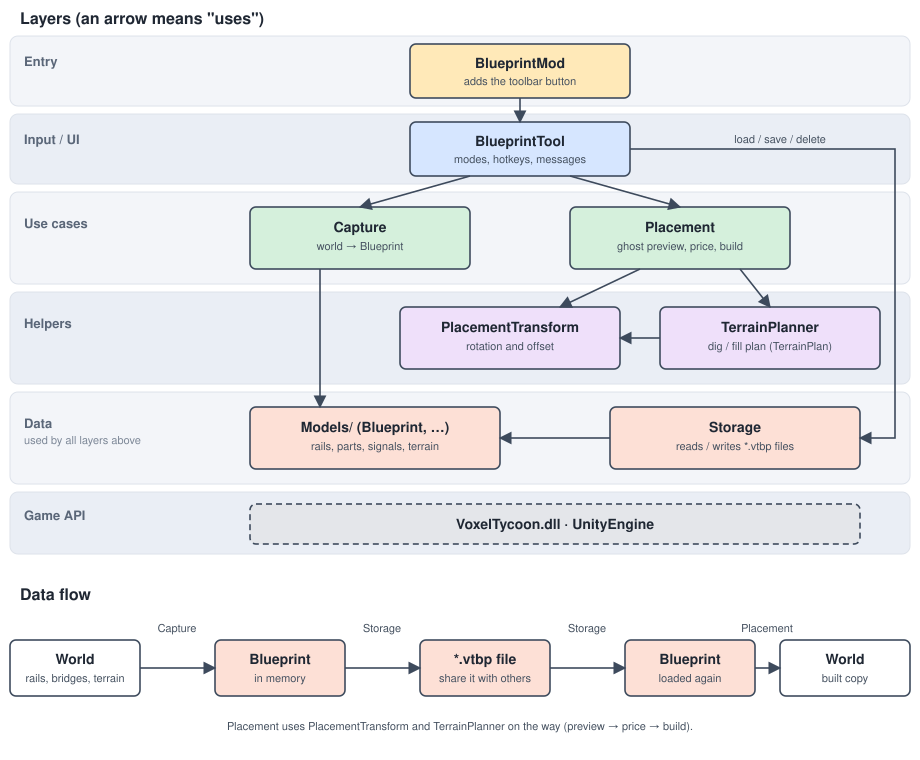

# Rail Blueprints

A Voxel Tycoon mod: build a rail junction once, save it as a blueprint and paste it anywhere.

Copied together with the rails: signals, electrification, bridges, tunnels (including piers) and the shape of the
terrain underneath. Blueprints can be rotated before placing.

## Usage

Open the **Rail blueprints** button in the toolbar. **Tab** switches between the two modes.

| Mode    | Key                        | Action                                           |
|---------|----------------------------|--------------------------------------------------|
| Capture | Left mouse, drag           | Mark a rectangle; the rails inside are saved     |
| Place   | Q / E                      | Previous / next blueprint                        |
| Place   | R                          | Rotate by 90°                                    |
| Place   | X / Z (or Page Up / Down)  | Move the blueprint one voxel up / down           |
| Place   | F                          | Toggle terrain adjustment                        |
| Place   | Delete                     | Delete the selected blueprint                    |
| Place   | Left mouse                 | Build (the preview shows price, red = blocked)   |

The lowest rail of a blueprint sits one voxel above the ground under the cursor. With terrain adjustment on, the
ground is dug or filled like in the original, which is part of the price.

Blueprints are text files (`*.vtbp`) in `<Unity persistentDataPath>/Blueprints`, e.g. on macOS
`~/Library/Application Support/VoxelTycoon/VoxelTycoon/Blueprints`. They can be renamed and shared.

## Sharing blueprints

A blueprint is a single small text file, so sharing means copying that file. There is no in-game import or export
button.

### Send a blueprint

1. Open the blueprints folder (see the table below).
2. Send the `.vtbp` file, e.g. by chat, forum or Discord. The file name is the blueprint's name in the game, so
   rename it first (`4-way-turbine.vtbp`) if you like.

### Use a blueprint you received

1. Put the `.vtbp` file into your blueprints folder.
2. Open the **Rail blueprints** tool again (blueprints are read when the tool is opened). It shows up in the
   list; switch with **Q / E**.

| System  | Blueprints folder                                                         |
|---------|---------------------------------------------------------------------------|
| macOS   | `~/Library/Application Support/VoxelTycoon/VoxelTycoon/Blueprints`        |
| Windows | `%USERPROFILE%\AppData\LocalLow\VoxelTycoon\VoxelTycoon\Blueprints`        |
| Linux   | `~/.config/unity3d/VoxelTycoon/VoxelTycoon/Blueprints`                    |

The folder is created when the tool is opened for the first time. If your system differs, the exact path is
`Application.persistentDataPath` + `/Blueprints`.

### Good to know**

- Blueprints refer to rails, bridges, tunnels and signals by asset name (e.g. `base/regular.rail`). If one of them
  comes from another mod, the other player needs that mod too; otherwise the preview stays red.
- The mod does not check research: pieces the player has not unlocked yet can still be placed from a blueprint.
- Blueprints saved with the first version of this mod (file header `VTBP1`) contain no bridges, tunnels or terrain.
  Capture them again.
- A blueprint is not tied to a savegame: it works in every game on the same computer.

### Safety of blueprint files

Blueprint files are treated as untrusted input. A file is checked when it is loaded and ignored (with a warning in the
game's `Player.log`) if anything is wrong: too large, malformed, values out of range, undefined enum values, broken
indices, parent links that form a cycle, or asset names that are not rails, bridges, tunnels or signals. Prices always
come from the game, never from the file, and file contents are never executed. The limits are in
`Validator.cs` and `Storage.cs`.

## Build and install

Requires the .NET SDK 8 or newer. `VoxelTycoon.dll` is referenced from your game installation; the standard Steam locations
for Windows, macOS and Linux are preconfigured in `Directory.Build.props`.

```sh
dotnet build src/BlueprintMod -c Release -p:InstallMod=true
```

builds the mod and copies `BlueprintMod.dll`, `mod.json` and `preview.png` to `<game>/Content/BlueprintMod`.
Without `-p:InstallMod=true` it only builds (output in `src/BlueprintMod/bin/Release/netstandard2.1`).

If the game is installed somewhere else, pass its folder:

```sh
dotnet build src/BlueprintMod -c Release -p:InstallMod=true -p:VoxelTycoonDir="D:\Games\VoxelTycoon"
```

The game loads a mod DLL only once per process, so quit it completely and restart after every install.

## Tests

Automatic tests cover the code that does not need the running game: the file format and its validation, the
rotation maths and the terrain plan. They are in `tests/BlueprintMod.Tests` (xUnit) and need the game installed,
because they use its plain data types such as `Xyz`.

```sh
dotnet test
```

Capture, placement and the tool depend on the running game world and are checked by hand. After changes to them, try
this in a game with some rails:

1. Build a junction with a bridge, a tunnel, signals and electrification on dug-out ground. Mark it in capture mode.
2. Place it on flat ground: the preview is green, the price includes the terrain work, and the result matches the original.
3. Place it rotated by 90, 180 and 270 degrees (R); signals must point the same way as in the original.
4. Move it with X / Z, toggle terrain adjustment with F, and try to place it where something is in the way (red).
5. Quit the game completely, start it again and check that the blueprint is still in the list.

## Code style

The code follows the [Microsoft C# coding conventions](https://learn.microsoft.com/en-us/dotnet/csharp/fundamentals/coding-style/coding-conventions).
The rules are configured in `.editorconfig` and checked by every build (`EnforceCodeStyleInBuild`). To check or fix
the style on its own:

```sh
dotnet format style --verify-no-changes   # check
dotnet format style                       # fix what can be fixed automatically
```

Deliberate deviation: lines may be up to 120 characters; the 65 characters of the docs guideline are meant for
documentation pages.

## Repository layout

```
BlueprintMod.sln
Directory.Build.props        settings shared by all projects, default game paths
.editorconfig                code style, checked by every build
docs/                        architecture diagram
src/BlueprintMod/            the mod: code, mod.json, preview.png
tests/BlueprintMod.Tests/    unit tests
```

## Code overview

All files below are in `src/BlueprintMod/`.

| File                                  | Purpose                                                   |
|---------------------------------------|-----------------------------------------------------------|
| `BlueprintMod.cs`                     | Mod entry point, adds the toolbar button                  |
| `BlueprintTool.cs`                    | Input, modes and hotkey panel                             |
| `Capture.cs`                          | World -> `Blueprint`                                      |
| `Placement.cs`                        | Ghost preview, price/validity, building the blueprint     |
| `PlacementTransform.cs`               | Rotation and offset of saved positions                    |
| `TerrainPlan.cs`, `TerrainPlanner.cs` | Which terrain columns to dig or fill                      |
| `Models/`                             | Data model, one file per type (`Blueprint`, `RailEntry`, ...) |
| `Storage.cs`                          | Reading and writing `.vtbp` files                         |
| `Serializer.cs`                       | File format: `Blueprint` <-> lines of text                |
| `Validator.cs`, `AssetLibraryExtensions.cs` | Validation of loaded files, safe asset lookup       |

## Architecture



Each layer only uses the layers below it. `BlueprintTool` is the only class that deals with input and UI, capture and
placement are independent of each other, and the data model (`Models/`) is plain data that every
layer can use. One small dependency is not drawn: capture asks `Storage` for the next free blueprint name.

The diagram is a hand-written SVG in `docs/architecture.svg`; edit it in any text editor.

## Disclaimer

This is a vibe coded application, with the help of Claude Sonnet 5.5. I'm a software developer and reviewed the code but comes without any guarantees.

## License

[MIT](LICENSE). Voxel Tycoon and its DLLs are not part of this repository and are not covered by this license.
